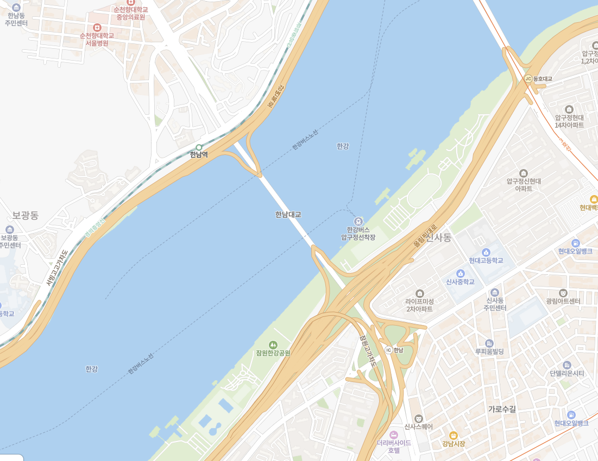
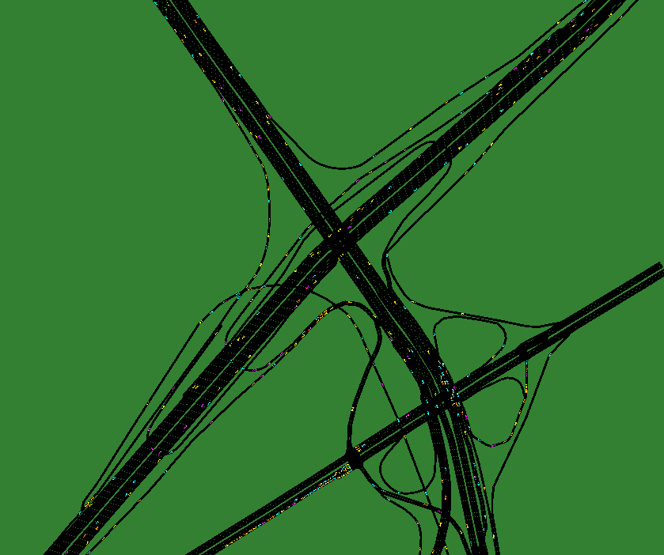

# 진출로 끼어들기 (Exit Ramp Cut-In)

> **성균관대학교 자율주행 인공지능 및 제어 · 11조** (이동건 · 신민지 · 한상우)  
> 한남대교 남단 나들목 일대를 SUMO로 재현하고, 정체된 진출 차로 대기열에 끼어드는 자율주행 의사결정을 **PPO(Proximal Policy Optimization)** 로 학습한 프로젝트입니다.

- **프로젝트 소개:** [https://dmdk1999-svg.github.io/SKKU_Auto_Driving_Project/](https://dmdk1999-svg.github.io/SKKU_Auto_Driving_Project/)
- **리포지토리:** [dmdk1999-svg/SKKU_Auto_Driving_Project](https://github.com/dmdk1999-svg/SKKU_Auto_Driving_Project)

---

## 개요

진출 차량이 몰리는 도시고속도로·간선도로 나들목에서는 진출 연결 차로만 정체되고 인접 본선 차로는 원활한 경우가 많습니다. 진출부 직전에 도착한 자율주행 차량(AV)은 대기열 후미 합류가 불가능하므로, 인접 차선 후행차의 감속 반응과 간격 변화를 관측하며 **정체 대기열 중간 진입 · 차선 경계 대기 · 위험 시 복귀**를 판단해야 합니다.

<p align="center">
  
  
</p>

- **입체 도로 환경:** OpenStreetMap(`hannam_south.osm`) 기반으로 한남대교 남단 ~ 신사역 사거리 일대의 고저차 입체 교차로, 연결 램프, 편중된 진출 대기열과 6개 주행 시나리오를 구성했습니다.
- **연속 끼어들기 제어:** SUMO `SL2015` sublane 모델을 적용해 좁은 대기열 간격에 차체 일부를 걸치고 후행차 반응을 보며 진입·대기·취소를 결정합니다.
- **학습 정책:** 52차원 부분 관측과 3차원 Hybrid 행동(종방향 가감속, 3-way 차선변경 트리거, 기동 횡가속도)을 바탕으로 PPO 강화학습 및 수집 데이터 기반 BC 모방학습을 지원합니다.

> 도로 구축 과정, 시나리오별 제원, 끼어들기 기동 및 관측·보상 설계, 문제 해결 과정 등 자세한 내용은 **[프로젝트 소개 페이지](https://dmdk1999-svg.github.io/SKKU_Auto_Driving_Project/)** 에서 확인할 수 있습니다.

---

## 설치 및 환경 구성

### 1. 사전 요구사항

1. **Eclipse SUMO (1.27 이상 권장)** 및 `SUMO_HOME` 설정
   - 실행 시 OS별 기본 설치 경로(`/usr/share/sumo`, `/opt/homebrew/opt/sumo/share/sumo`, `C:\Program Files (x86)\Eclipse\Sumo` 등)를 자동 탐색하지만, `sumo`, `sumo-gui`, `netconvert` 명령이 설치되어 있어야 합니다.
   - Linux (Ubuntu/Debian):
     ```bash
     sudo apt install sumo sumo-tools
     export SUMO_HOME=/usr/share/sumo
     ```
   - Windows / macOS 설치 가이드는 [`project_materials/1_SUMO_Windows_Setup.md`](./project_materials/1_SUMO_Windows_Setup.md), [`project_materials/1_SUMO_macOS_AppleSilicon_Setup.md`](./project_materials/1_SUMO_macOS_AppleSilicon_Setup.md)를 참고하세요.
2. **Python 환경**
   - `pyproject.toml` 기준 **Python 3.14 이상** (`uv` 사용 시 자동 구성)

### 2. 패키지 설치

#### 방법 A: `uv` 사용 (권장)

```bash
uv sync
```

> 이후 명령어는 `uv run python <스크립트>.py`로 실행하거나 `.venv` 가상환경을 활성화한 뒤 실행합니다.

#### 방법 B: `pip` 사용

```bash
python -m pip install torch gymnasium traci sumolib tensorboard
```

> **참고 (`libsumo`):** GUI 없는 실행에서는 기본적으로 in-process 백엔드(`SIMULATION["use_libsumo"] = True`)를 사용합니다. `libsumo`가 없는 환경이라면 `pip install libsumo`로 설치하거나 `env/mdp_config.py`에서 `"use_libsumo": False`로 변경하세요.

---

## 실행 방법

모든 실행 스크립트는 시작 시 `env/road_config.py` 기준으로 `env/sumo/` 아래 SUMO 네트워크 파일을 자동 생성합니다.

### 1. 도로망 및 교통 흐름 확인 (`view_road.py`)

```bash
# sumo-gui로 도로망 열기 (창이 뜨면 상단 ▶ 버튼으로 주행 재생)
python view_road.py

# GUI 없이 도로 생성 및 120초 시뮬레이션 검증
python view_road.py --nogui --seconds 120
```

> `env/road_config.py`의 `ROAD["osm"]["enabled"]`를 `False`로 바꾸면 기본 직선/사거리 트랙으로 전환됩니다.

### 2. PPO 강화학습 (`train.py`)

```bash
python train.py
```

- **실험 설정:** [`train.py`](./train.py) 상단의 `TOTAL_TIMESTEPS`, `REWARD_OVERRIDES`, `HPARAMS`, `N_ENVS`(병렬 환경 수), `RESUME`(체크포인트 이어 학습 경로, 처음부터 학습 시 `None`)에서 조정합니다.
- **저장 경로:** `results/run_YYYYMMDD_HHMMSS/` 아래에 `model.pt`, `best_model.pt`, `checkpoints/`, CSV/TensorBoard 로그, 설정 스냅샷이 저장됩니다.

### 3. 주행 데이터 수집 (`collect_pomdp_data.py`)

정책으로 주행 궤적을 수집하여 `data/` 폴더에 `.npz`(BC 학습용)와 `.jsonl.gz`(전체 상태 검증용)를 저장합니다.

```bash
# 학습된 모델로 200 에피소드 병렬 수집 (워커 8개)
python collect_pomdp_data.py --model results/run_YYYYMMDD_HHMMSS/best_model.pt --episodes 200 --workers 8

# 확률적 행동 샘플링으로 수집 (--stochastic)
python collect_pomdp_data.py --model results/run_YYYYMMDD_HHMMSS/best_model.pt --stochastic --episodes 200 --workers 8

# 기본 정책(random / keep-lane)으로 GUI 확인하며 수집
python collect_pomdp_data.py --policy keep-lane --episodes 10 --gui
```

### 4. 모델 평가 및 주행 재생 (`test.py`, `measure_collisions.py`)

PPO/BC 모델 종류를 자동 판별하여 GUI 재생 또는 정량 지표 측정을 수행합니다.

```bash
# 가장 최근 모델을 sumo-gui로 재생 (창이 뜨면 ▶ 버튼 클릭)
python test.py

# 특정 모델 또는 체크포인트 지정 재생
python test.py results/run_YYYYMMDD_HHMMSS/best_model.pt
python test.py results/run_YYYYMMDD_HHMMSS/checkpoints/ckpt_622592.pt

# GUI 없이 정량 지표(완주율·충돌률·평균 주행 시간 등) 측정
python test.py results/run_YYYYMMDD_HHMMSS/best_model.pt --episodes 50 --nogui
python test.py results/bc_MMDD_HHMM/model.pt --algorithm bc --episodes 50 --nogui

# 충돌 유형별 집계 및 CSV 기록
python measure_collisions.py results/run_YYYYMMDD_HHMMSS/best_model.pt --episodes 50 --out collisions.csv
```

### 5. 학습 곡선 확인 (TensorBoard)

```bash
tensorboard --logdir results
# http://localhost:6006 접속
```

---

## 코드 구조

```text
SKKU_Auto_Driving_Project/
├── env/
│   ├── road_config.py          # 도로 · AV · 일반 차량 설정
│   ├── mdp_config.py           # 관측 · 행동 · 보상 · 시뮬레이션 설정
│   ├── osm/                    # OpenStreetMap 원본 데이터
│   ├── osm_road.py             # OSM 도로 추출, 고도 부여, 경로/교통류 생성
│   ├── net_repair.py           # SUMO 네트워크 차선 연결·신호 보정
│   ├── road_builder.py         # SUMO 실행 파일(.net.xml, .rou.xml, .sumocfg) 빌드
│   ├── sumo_env.py             # Gymnasium 환경 및 TraCI/libsumo 제어
│   └── vec_env.py              # 멀티프로세스 병렬 SUMO 환경
│
├── algorithms/
│   ├── ppo.py                  # PPO 알고리즘
│   └── bc.py                   # Behavior Cloning 정책
│
├── utils/
│   ├── networks.py             # 정책·가치 신경망
│   ├── buffer.py               # 롤아웃 버퍼
│   ├── evaluator.py            # 주행 성능 평가기
│   ├── collision.py            # 충돌 유형 분류기
│   └── logger.py               # CSV · TensorBoard 로거
│
├── view_road.py                # 도로망 및 교통 흐름 확인
├── train.py                    # PPO 학습 실행
├── collect_pomdp_data.py       # POMDP 주행 데이터 병렬 수집
├── train_bc.py                 # BC 모방학습 실행
├── test.py                     # 모델 주행 재생 및 평가
├── measure_collisions.py       # 충돌 상황 분석 및 집계
└── docs/                       # 프로젝트 소개 페이지 (GitHub Pages)
```

---

> 성균관대학교 자율주행 인공지능 및 제어 · 11조 
>
> 도로 데이터 © OpenStreetMap contributors (ODbL)
